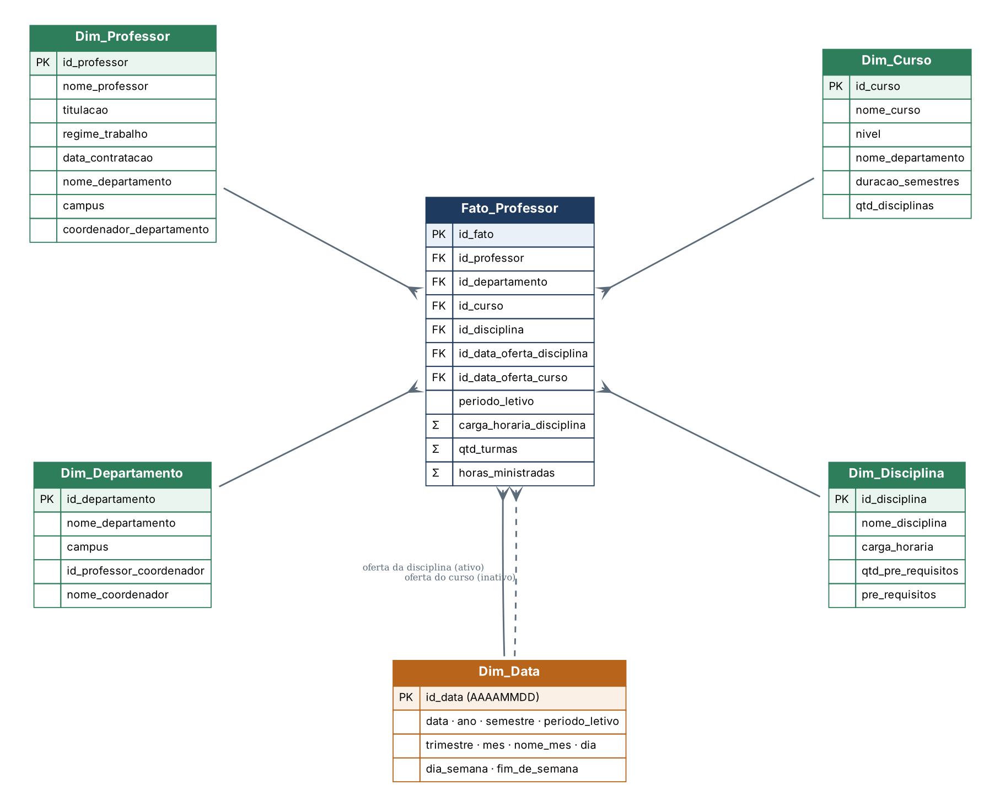
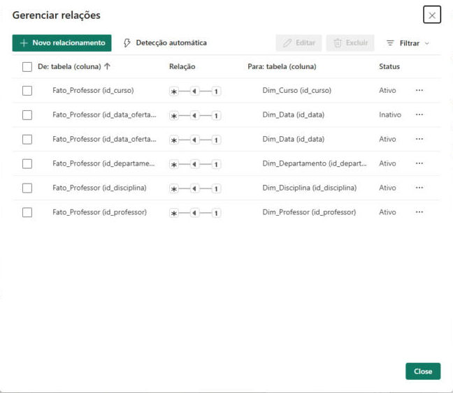
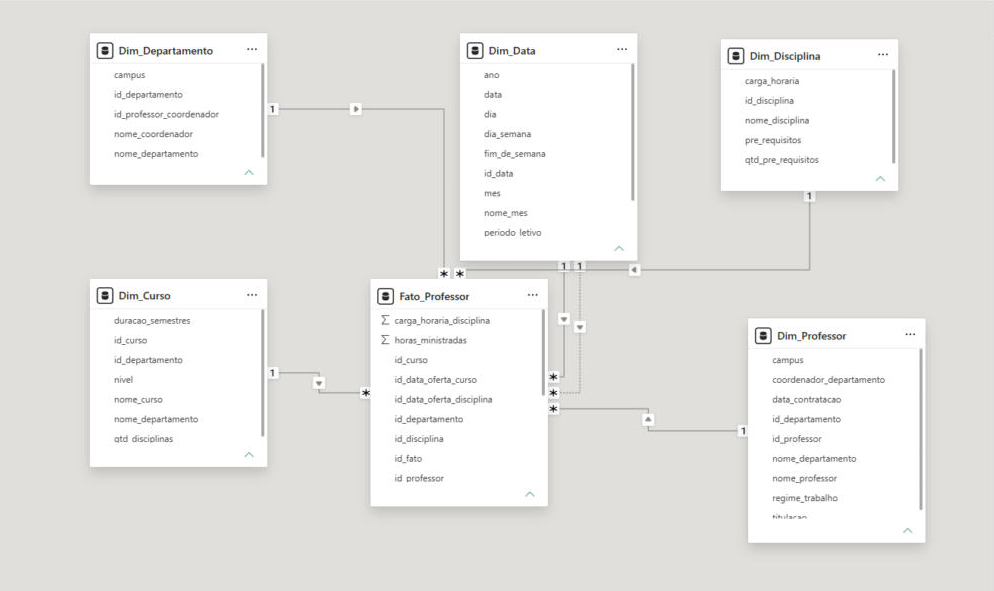
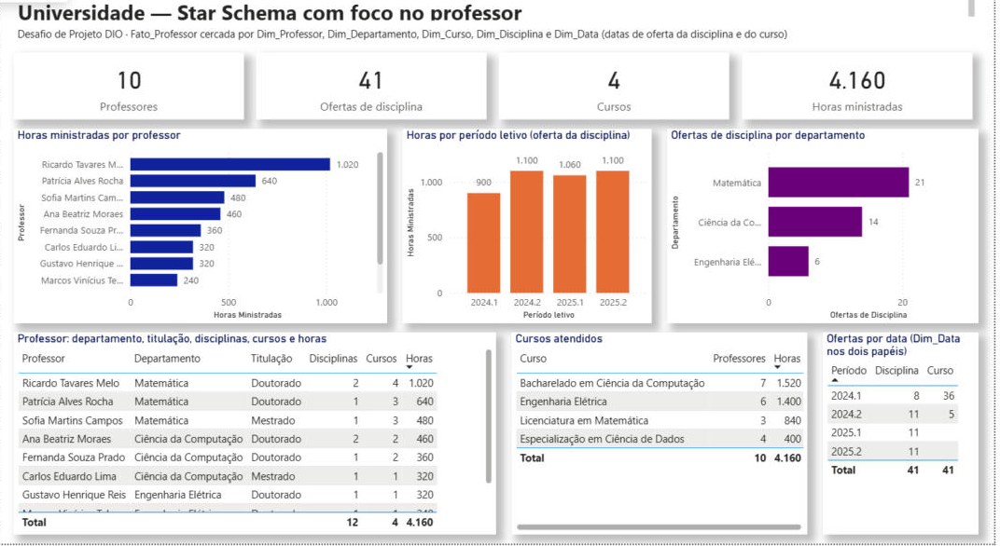

# Desafio de Projeto DIO — Star Schema: Universidade com foco no professor

Quarto desafio de projeto da formação **Power BI Analyst** da [DIO](https://www.dio.me/): partir do diagrama relacional da universidade e criar um **esquema em estrela (star schema)** cujo objeto de análise é o **professor**, com uma tabela fato, suas dimensões e uma dimensão de datas com campos supostos (datas de oferta das disciplinas e dos cursos).



## Arquivos

| Pasta / arquivo | Conteúdo |
|---|---|
| `diagrama/` | Diagrama do star schema (`star_schema.png`, `.svg` e a fonte `.dot` do Graphviz) |
| `modelo-relacional/` | Diagrama relacional de referência fornecido no desafio (`der_universidade.png`) |
| `sql/star_schema_universidade.sql` | DDL das seis tabelas do esquema estrela, com chaves primárias e estrangeiras |
| `dados/` | Massa de dados de exemplo em CSV, uma por tabela (41 linhas na fato, 731 dias na dimensão de datas) |
| `star_schema_universidade.pbix` | Modelo carregado no Power BI, com relacionamentos, medidas DAX e uma página de análise |
| `pbip/` | O modelo semântico em TMDL (`model.tmdl`, `relationships.tmdl`, `tables/*.tmdl`), legível no GitHub, e o projeto completo (TMDL + PBIR) em `star_schema_universidade_pbip.zip` |
| `power-query/` | Código M de cada tabela e as medidas DAX (`medidas.dax`) |
| `prints/` | Modelo no Power BI, janela de relacionamentos e página de análise |

## Ponto de partida: o modelo relacional

O diagrama relacional tem oito tabelas: `Professor`, `Departamento`, `Curso`, `Disciplina`, `Disciplina & Curso`, `Pré-requisitos`, `Aluno` e `Matriculado`. As ligações relevantes para o professor:

- `Professor` pertence a um `Departamento` (`Departamento_idDepartamento`) e o departamento tem um professor coordenador (`idProfessor_coordenador`).
- `Disciplina` é dada por um professor (`Professor_idProfessor`) e pode ter pré-requisitos (`Pré-requisitos das disciplinas`).
- `Curso` pertence a um departamento e é composto por disciplinas por meio da associativa `Disciplina & Curso`.
- `Aluno` e `Matriculado` ficam fora do esquema, como o enunciado permite: o foco é o professor, não o aluno.

## O star schema

| Tabela | Papel | Grão / chave |
|---|---|---|
| **Fato_Professor** | Fato | Uma linha por **professor × disciplina × curso × período letivo de oferta** |
| **Dim_Professor** | Dimensão | Um professor (`id_professor`) |
| **Dim_Departamento** | Dimensão | Um departamento (`id_departamento`) |
| **Dim_Curso** | Dimensão | Um curso (`id_curso`) |
| **Dim_Disciplina** | Dimensão | Uma disciplina (`id_disciplina`) |
| **Dim_Data** | Dimensão de datas (role-playing) | Um dia (`id_data` no formato AAAAMMDD) |

### Fato_Professor

A fato responde às perguntas sobre o professor: o que ele ministra, para qual curso, em qual departamento e quando. Cada linha é uma oferta de disciplina em um período letivo.

| Coluna | Tipo | Descrição |
|---|---|---|
| `id_fato` | PK | Identificador da linha |
| `id_professor` | FK → Dim_Professor | Professor que ministra a disciplina |
| `id_departamento` | FK → Dim_Departamento | Departamento do professor |
| `id_curso` | FK → Dim_Curso | Curso em que a disciplina é oferecida (vem de `Disciplina & Curso`) |
| `id_disciplina` | FK → Dim_Disciplina | Disciplina ministrada |
| `id_data_oferta_disciplina` | FK → Dim_Data | Data de início da oferta da disciplina no período |
| `id_data_oferta_curso` | FK → Dim_Data | Data em que o curso passou a ser ofertado |
| `periodo_letivo` | atributo degenerado | Ex.: `2025.1` |
| `carga_horaria_disciplina` | medida | Carga horária da disciplina (h) |
| `qtd_turmas` | medida | Turmas abertas naquela oferta |
| `horas_ministradas` | medida | `carga_horaria_disciplina × qtd_turmas` |

O enunciado deixa a granularidade livre. A escolha de **oferta por período letivo** permite somar horas por professor, comparar semestres e contar quantas vezes uma disciplina foi dada, sem precisar descer ao nível de aula ou de aluno.

### Dimensões

**Dim_Professor** — `id_professor`, `nome_professor`, `titulacao`, `regime_trabalho`, `data_contratacao`, `id_departamento`, `nome_departamento`, `campus`, `coordenador_departamento` (Sim/Não). O nome do departamento e o campus foram **desnormalizados** para dentro da dimensão: em um esquema estrela as dimensões não se ligam entre si, então o professor carrega os atributos do seu departamento em vez de apontar para `Dim_Departamento`.

**Dim_Departamento** — `id_departamento`, `nome_departamento`, `campus`, `id_professor_coordenador`, `nome_coordenador`. O coordenador, que no relacional é uma chave estrangeira para `Professor`, aqui vira um atributo textual.

**Dim_Curso** — `id_curso`, `nome_curso`, `nivel` (Graduação / Pós-graduação), `id_departamento`, `nome_departamento`, `duracao_semestres`, `qtd_disciplinas`.

**Dim_Disciplina** — `id_disciplina`, `nome_disciplina`, `carga_horaria`, `qtd_pre_requisitos`, `pre_requisitos`. A tabela `Pré-requisitos das disciplinas` (N:N) foi achatada em dois atributos: a quantidade e a lista de pré-requisitos separada por `;`. Para a análise do professor isso basta, e evita trazer uma ponte para o modelo.

**Dim_Data** — `id_data` (AAAAMMDD), `data`, `ano`, `semestre`, `periodo_letivo` (ex.: `2025.1`), `trimestre`, `mes`, `nome_mes`, `dia`, `dia_semana`, `fim_de_semana`. Cobre 2024-01-01 a 2025-12-31, um registro por dia. A granularidade é o **dia**, mas as colunas `periodo_letivo`, `semestre`, `trimestre` e `ano` permitem analisar em níveis mais altos sem outra tabela.

### Dimensão de datas em dois papéis (role-playing)

O modelo relacional não tem datas, então foram supostas duas, como o enunciado sugere: **data de oferta da disciplina** e **data de oferta do curso**. As duas ficam na fato como chaves para a mesma `Dim_Data`. No Power BI isso vira dois relacionamentos:

| Relacionamento | Status |
|---|---|
| `Fato_Professor[id_data_oferta_disciplina]` → `Dim_Data[id_data]` | **Ativo** (é a data usada por padrão nos visuais) |
| `Fato_Professor[id_data_oferta_curso]` → `Dim_Data[id_data]` | **Inativo** (acionado por `USERELATIONSHIP` quando a análise é pela data do curso) |

Só um dos dois pode ficar ativo, senão haveria dois caminhos entre a fato e a dimensão. A medida abaixo usa o caminho inativo:

```dax
Ofertas por Data do Curso =
CALCULATE([Ofertas de Disciplina], USERELATIONSHIP(Fato_Professor[id_data_oferta_curso], Dim_Data[id_data]))
```



## Modelo no Power BI



As seis tabelas são lidas dos CSV em `dados/` pelo Power Query (parâmetro `PastaDados`), com uma consulta por tabela: **Fonte → Cabeçalhos Promovidos → Tipo Alterado**. Os relacionamentos são todos **muitos-para-um** da fato para as dimensões, com filtro em direção única, como manda o esquema estrela.

Medidas DAX criadas na fato (`power-query/medidas.dax`): `Horas Ministradas`, `Qtd Turmas`, `Ofertas de Disciplina`, `Professores Ativos`, `Cursos Atendidos`, `Disciplinas Distintas`, `Média de Horas por Professor` e `Ofertas por Data do Curso`.

## Página de análise



A página **Análise do professor** serve para validar o modelo: cartões (10 professores, 41 ofertas, 4 cursos, 4.160 horas), horas ministradas por professor, horas por período letivo, ofertas por departamento, a tabela professor × departamento × titulação × disciplinas × cursos × horas, os cursos atendidos e a tabela que compara `Dim_Data` nos dois papéis (pela data da disciplina as ofertas se distribuem pelos quatro períodos; pela data do curso elas se concentram em 2024.1 e 2024.2, quando os cursos começaram a ser ofertados).

## Massa de dados

Os dados em `dados/` foram criados para o exercício: 3 departamentos, 10 professores, 4 cursos, 12 disciplinas e 41 ofertas em quatro períodos letivos (2024.1 a 2025.2). Para trocar a fonte por um banco real, basta substituir a etapa **Fonte** de cada consulta; os nomes das colunas seguem o DDL em `sql/`.

## Como abrir

1. Baixe `star_schema_universidade.pbix` e abra no Power BI Desktop. Os dados já estão carregados.
2. Para atualizar a partir dos CSV, baixe a pasta `dados/` e, em **Transformar dados > Gerenciar parâmetros**, aponte `PastaDados` para ela.
3. O diagrama pode ser regenerado com `dot -Kneato -Tpng diagrama/star_schema.dot -o diagrama/star_schema.png`.

## Referência

Repositório do curso: [julianazanelatto/power_bi_analyst](https://github.com/julianazanelatto/power_bi_analyst)
